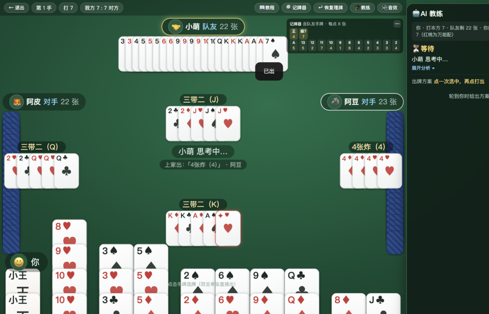
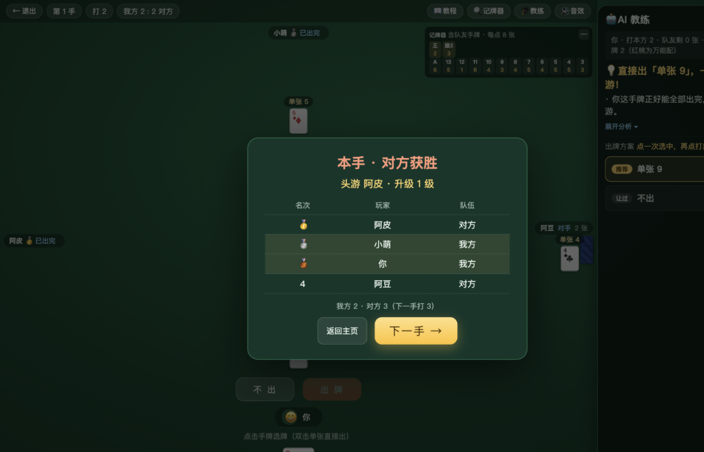
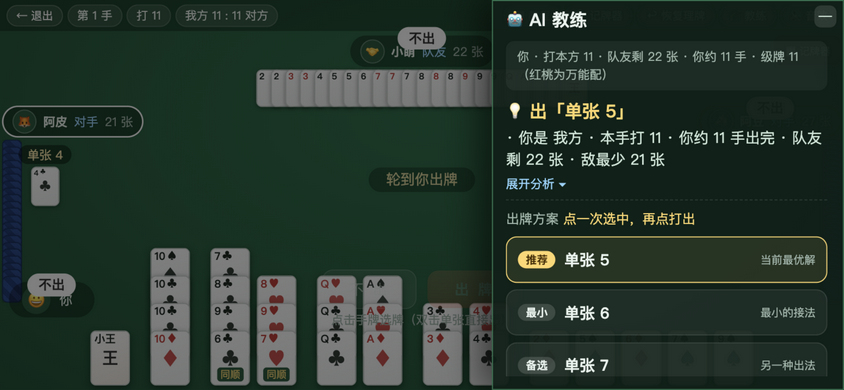

# 🃏 Guandan Master Trainer (掼蛋 AI 训练营)

> A web game that helps you **learn Guandan from your very first hand** — a complete, authentic Guandan match with an AI coach explaining every move. Pure frontend, zero dependencies, double-click to play.

**[🎮 Play Online](https://studyguy.github.io/guandan-master-glm/)** · **[📦 Source Code](https://github.com/studyguy/guandan-master-glm)**



---

## 🕹️ What Is This

Guandan's rules aren't hard — what's hard is that **nobody tells you why a hand should be played a certain way**. This project merges a real match with live coaching: you play full, authentic Guandan (two decks · 4 players in 2 teams · levels 2 through Ace), and every time it's your turn the **AI coach** on the side suggests a play with a plain-language explanation. The opponent bots come in three difficulties, from a mistake-prone beginner sparring partner to a master who counts hands, saves bombs, and pressures reported hands.

All logic runs client-side (no external API calls) — **fully offline-capable**, and installable as a PWA for native fullscreen play.

## ✨ Features

- **Complete Guandan flow**: 108 cards dealt in full → level card (current rank) → trick-taking / free lead (接风) → winner sets the order → team scoring (+3 / +2 / +1) → clear Ace to win the match
- **🎓 AI coach sidebar**: situation overview + collapsible Chinese analysis + **clickable plan list** (recommendation always first); docks right on desktop, drawer on mobile, auto-collapses after each hand
- **Teaching-style feedback**: real-time combo name and "can you beat the last play?" while selecting; illegal plays explained in plain Chinese; play button grays out dynamically
- **Three bot difficulties**: 🐣 Beginner (makes mistakes) / ⚔️ Intermediate (splits combos, saves bombs, holds back) / 🔥 Master (minimum-hand decomposition, yields to teammate, pressures reported hands)
- **Learning aids**: 5-chapter newbie tutorial, card counter (including teammate reveals), low-card alerts (≤10 cards), free-lead hints, three card-sorting modes, drag-select, cross-match stats (localStorage)
- **Hand-over summary**: placement table (🥇🥈🥉 badges), level progression ("Us: 5 ➜ 8 (+3)"), match-clear popup with victory confetti
- **Multi-device**: desktop / narrow-screen drawer / landscape phone compact mode / portrait rotation hint; one-tap fullscreen + landscape lock; 20 WebAudio-synthesized SFX + looping BGM; prefers-reduced-motion support

## 🎯 Gameplay at a Glance

- **Teams**: you and the player opposite are partners (teammate's cards revealed); you vs. the two players on the sides
- **Level card**: each hand plays to a rank (match starts at 2); the heart level card is the wild card (逢人配) that can become any non-joker combo
- **Combos**: single / pair / triple / full house / straight (exactly 5) / consecutive pairs (≥3) / consecutive triples (≥2) / bomb (4–8 of a kind) / straight flush / four-joker bomb
- **Ranking**: jokers > level card > A > K > … > 2; bombs beat non-bombs, more cards beat fewer
- **Winning**: the winning team levels up by partner placement; **your team takes the hand and the partner isn't last** → you clear Ace; first team to clear Ace wins the match
- **Free lead**: if nobody beats the final play of a hand, the winner's partner leads the next hand



## 🚀 Quick Start

| Method | How |
|---|---|
| 🌐 Play online | [studyguy.github.io/guandan-master-glm](https://studyguy.github.io/guandan-master-glm/) (auto-published via GitHub Actions) |
| 💻 Play locally | Clone the repo and double-click `index.html` (`file://` verified to work) |
| 🖥️ Local server | `npx http-server -p 8642 -c-1` or `python3 -m http.server 8642` |

**Run tests** (Node.js required):

```bash
node test/sim.js
# 39 logic assertions (combos / beating chains / wild cards / moves / coach / regression)
# + 3-difficulty × 20-hand 4-bot simulations + one full match (2 → Ace) upgrade verification
```

## 🛠️ Technical Notes

**The AI coach is a pure client-side heuristic** (works offline):

1. **Hand decomposition**: splits 27 cards into as few "plays" as possible — the core of situation evaluation
2. **Plan generation**: picks 1–6 candidates from legal moves (recommend / min / max / bomb / pass badges), recommendation always first
3. **Decision**: win outright if possible → pressure opponents' reported hands → yield to teammate → time bombs well; the coach layers Chinese explanations on top and critiques each of your plays

**Rule switches** (`DD.RULES` in `js/rules.js`, for regional variants): random start level, A2345 straights, joker pairs, no-joker kicker, back-to-2 after three failed Ace attempts, report threshold, tribute/return-tribute (reserved), settlement display.

**Debug hooks**: `?autotest=autoplay` for a full auto-played match, `&side=1` to force-open the coach, `?debug=1` to dump element bounding boxes.

## 📁 Project Structure

```
guandan-master-glm/
├── index.html            # Page structure (home / 4-player table / tutorial / summary)
├── css/style.css         # All styles (cards drawn in pure CSS, no images)
├── js/
│   ├── rules.js          # Rule switches + level ordering / upgrade tables
│   ├── cards.js          # 108-card deck generation, shuffle, sort
│   ├── combos.js         # Combo recognition (incl. wild cards) + comparison
│   ├── movegen.js        # Legal move enumeration (controlled wild expansion)
│   ├── ai.js             # Hand decomposition, three bot levels, master decisions
│   ├── advisor.js        # AI coach: suggestions + explanations + critique
│   ├── sfx.js            # WebAudio-synthesized sound effects
│   ├── game.js           # 4-player 2-team match state machine (event-driven)
│   ├── ui.js             # Table rendering and interaction
│   └── app.js            # Home, tutorial, auto-demo and debug hooks
├── docs/ARCHITECTURE.md  # Architecture decisions (read before extending)
├── docs/img/             # Screenshots
├── test/sim.js           # Logic assertions + bot simulations + full-match check
└── PROGRESS.md           # Progress log and handoff notes
```

## 📌 Current Status

Both the logic and presentation layers are complete and accepted (see [PROGRESS.md](PROGRESS.md)). The only reserved, unimplemented feature: **tribute / return-tribute / counter-tribute** (`rules.gong` switch reserved, off by default).


